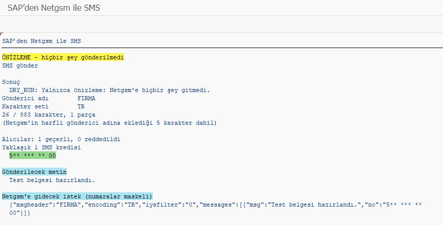

# SAP’den Netgsm ile SMS

[Türkçe](README.md) · [English](README.en.md) · [Ekran görüntülü kurulum ve kullanım rehberi](WALKTHROUGH.tr.md)

Bir belge hazır olduğunda ya da bir arka plan işi bittiğinde SAP’den SMS ile haber verebilirsiniz. `ZCHE_SMS_NETGSM` ile mesajı SAP’de hazırlayıp Netgsm üzerinden gönderirsiniz. İlk denemede **Yalnızca önizleme** seçeneğini açık bırakın. Böylece alıcıları, mesajın kaç parçaya bölüneceğini ve tahmini SMS kredisini gönderimden önce görürsünüz.

## Nereden başlamalı?

| Yapmak istediğiniz | Rehber |
|---|---|
| İlk kez kurmak | [Netgsm hesabı, SAP programı ve bağlantı](WALKTHROUGH.tr.md#kurulum) |
| Hesap bilgilerini kontrol etmek | [Gönderici adlarını ücretsiz listeleme](WALKTHROUGH.tr.md#baglanti-testi) |
| İlk SMS’i hazırlamak | [A4H ekranlarıyla önizleme ve gönderim](WALKTHROUGH.tr.md#onizleme) |
| Tek kullanımlık kod ya da şablonlu mesaj göndermek | [OTP SMS](WALKTHROUGH.tr.md#otp) · [Şablonlu SMS](WALKTHROUGH.tr.md#sablon) |
| Bir gönderimi takip etmek veya planlanmış gönderimi iptal etmek | [Teslim raporu ve iptal](WALKTHROUGH.tr.md#takip) |
| Mevcut ABAP programına SMS eklemek | [Çalıştırılabilir önizleme örneği](WALKTHROUGH.tr.md#kendi-programlarınızdan-kullanım) |

## SAP’de nasıl görünür?

A4H/001’de “Test belgesi hazırlandı.” metnini bir örnek numarayla önizledik. SAP bir geçerli alıcı, bir SMS parçası ve yaklaşık bir kredi hesapladı. Ekrandaki `DRY_RUN`, bu denemede SMS gönderilmediğini gösterir.

**Gerçek hesapta doğrulananlar.** SAP iki Netgsm hedefine bağlandı, şablon listesini okudu ve karakter sayımını sorguladı. Test hesabında onaylı gönderici adı olmadığı için telefona teslim açık kaldı. A4H’de kaydedilen 50 birim testinin sonuçları da doğrulama belgesinde yer alıyor. [Test sonuçları](VALIDATION.tr.md) · [Değişiklikler](CHANGELOG.md) · [MIT lisansı](LICENSE)
