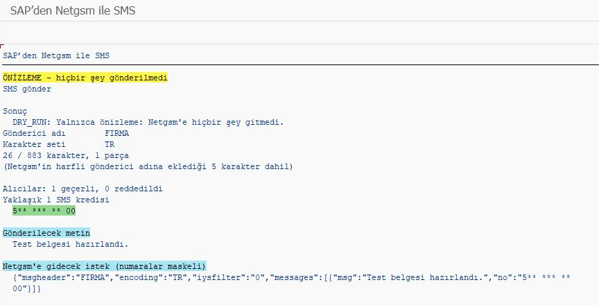

# SAP’den Netgsm ile SMS

[English](README.md) · [Türkçe](README.tr.md)

Bir belge hazır olduğunda ya da bir arka plan işi bittiğinde SAP’den SMS ile haber verebilirsiniz. `ZCHE_SMS_NETGSM` ile mesajı SAP’de hazırlayıp Netgsm üzerinden gönderirsiniz. İlk denemede **Yalnızca önizleme** seçeneğini açık bırakın. Böylece alıcıları, mesajın kaç parçaya bölüneceğini ve tahmini SMS kredisini gönderimden önce görürsünüz.

- SE38’e tek bir yürütülebilir program kopyalayıp etkinleştirin. Özel Veri Sözlüğü (DDIC) nesnesi gerekmiyor.
- Kaynak, ECC 6.0 için SAP_BASIS 7.00 sözdizimini hedefler. Her satır en fazla 72 sütundur.
- API kullanıcı kodunu ve şifreyi yalnızca SM59’a girin. Program hedefi kullanır ve şifreyi okumaz.

[Türkçe kurulum rehberi](WALKTHROUGH.tr.md) · [English walkthrough](WALKTHROUGH.md)

## Nereden başlamalı?

| Yapmak istediğiniz | Rehber |
|---|---|
| İlk kez kurmak | [Netgsm hesabı, SAP programı ve bağlantı](WALKTHROUGH.tr.md#kurulum) |
| Hesap bilgilerini kontrol etmek | [Gönderici adlarını ücretsiz listeleme](WALKTHROUGH.tr.md#baglanti-testi) |
| İlk SMS’i hazırlamak | [A4H ekranlarıyla önizleme ve gönderim](WALKTHROUGH.tr.md#onizleme) |
| Tek kullanımlık kod ya da şablonlu mesaj göndermek | [OTP SMS](WALKTHROUGH.tr.md#otp) · [Şablonlu SMS](WALKTHROUGH.tr.md#sablon) |
| Bir gönderimi takip etmek veya planlanmış gönderimi iptal etmek | [Teslim raporu ve iptal](WALKTHROUGH.tr.md#takip) |
| Gelen SMS’leri okumak veya bir gönderimin sayılarını görmek | [Gelen SMS](WALKTHROUGH.tr.md#gelen-sms) · [İş istatistikleri](WALKTHROUGH.tr.md#is-istatistikleri) |
| Bir arka plan işinden SMS göndermek | [SM36 ile önizleme ve gönderim](WALKTHROUGH.tr.md#arka-plan) |
| Mevcut ABAP programına SMS eklemek | [Çalıştırılabilir önizleme örneği](WALKTHROUGH.tr.md#kendi-programlarınızdan-kullanım) |

## SAP’de nasıl görünür?

A4H/001’de “Test belgesi hazırlandı.” metnini bir örnek numarayla önizledik. SAP bir geçerli alıcı, bir SMS parçası ve yaklaşık bir kredi hesapladı. Ekrandaki `DRY_RUN`, bu denemede SMS gönderilmediğini gösterir.

**Doğrulama.** SAP iki Netgsm hedefine bağlandı, şablon listesini okudu ve karakter sayımını sorguladı. Test hesabında onaylı gönderici adı bulunmadığı için telefona teslim doğrulanamadı. A4H’de (istemci 001, SAP_BASIS 816) 51 ABAP Unit testinin tamamı geçti. Aynı sistemde OTP önizlemesi kodu ve istek gövdesini göstermedi. [Test sonuçları](VALIDATION.tr.md) · [Değişiklikler](CHANGELOG.md) · [MIT lisansı](LICENSE)

SAP ve Netgsm, sahiplerinin ticari markalarıdır. Bu proje ikisiyle de bağlantılı değildir ve onlar tarafından onaylanmamıştır.
