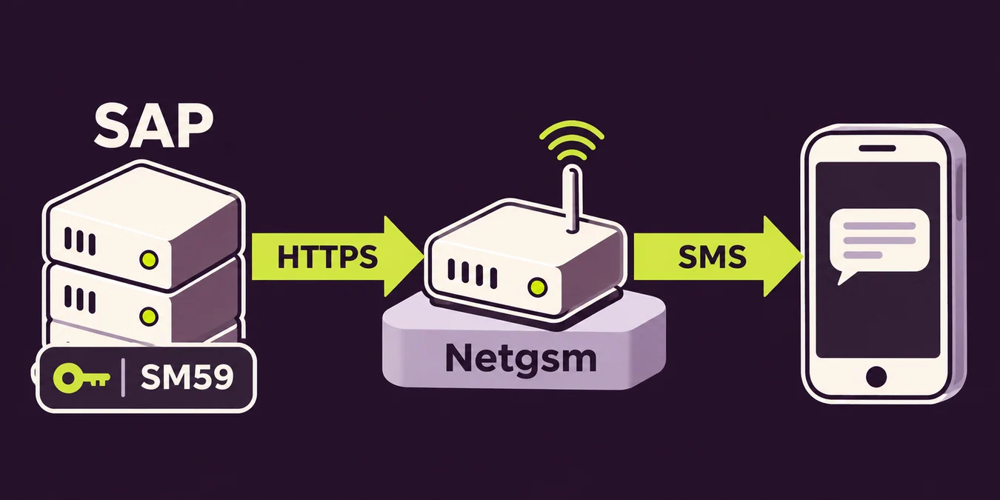
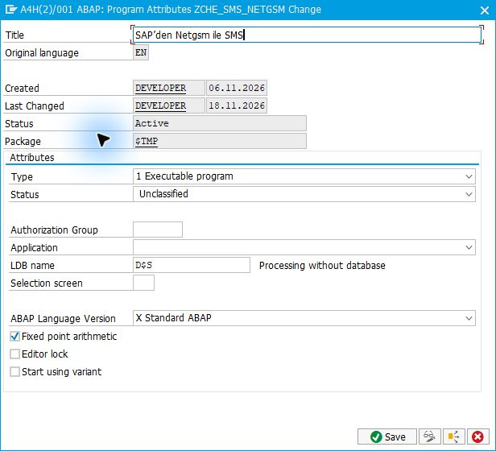
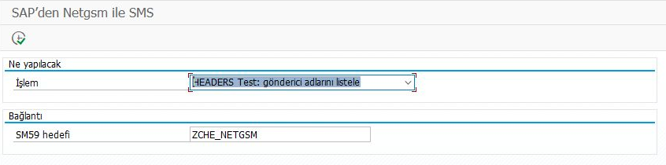
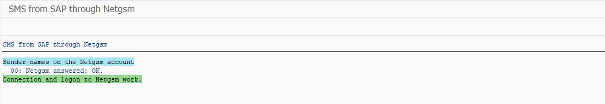
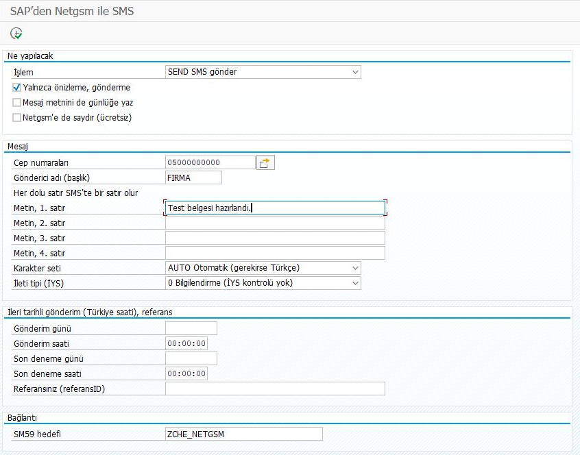
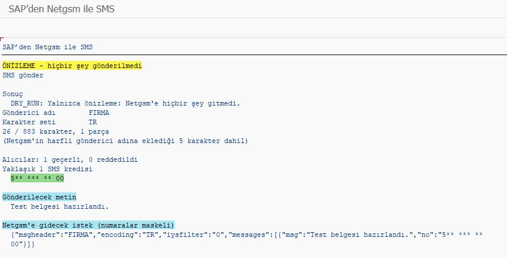
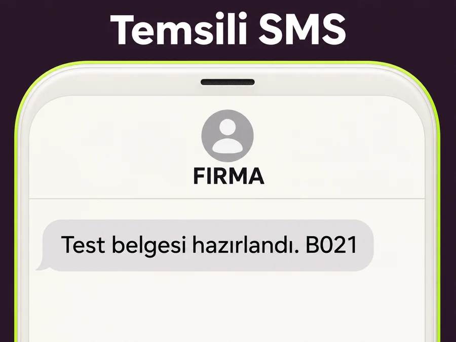

# Send SMS from SAP through Netgsm

[Türkçe](WALKTHROUGH.tr.md) · [Overview](README.en.md) · [Validation](VALIDATION.md)

Apply for a sender name first. While approval is pending, you can test the connection and preview a message for free.



### 1. Prepare the Netgsm account

<picture>
  <source media="(prefers-color-scheme: dark)" srcset="docs/img/netgsm-light.svg">
  
</picture>

1. **Sender name.** In the main account open **SMS → SMS Ayarları → Gönderici Adlarım**. Apply with supporting documents and submit the form via KEP (registered electronic mail). The test account was asked for proof of identity and authority. Approval can take days. Enter the approved spelling in SAP. An OTP request using the subscriber number as the sender returned `40`.
2. **Package.** Bulk SMS covers standard and template messages. OTP SMS is for a single-part code to one number.
3. **API sub-user.** Under **Abonelik İşlemleri → Alt Kullanıcı Hesapları**, use an approved API sub-user with **SMS Hizmeti** access. The panel notes date this requirement to 15 February 2024. In SM59 the username is the subscriber number and the password belongs to the API sub-user. The panel API key is for v3. The program uses REST v2 with HTTP Basic.
4. **IP access.** Ask the network team for the public IP that the SAP application server uses for outgoing traffic. Check it under **API İşlemleri → API IP Erişim Yönetimi**. When the address was missing, the test returned `30` and the account owner received a free alert SMS. See **Bildirimler → Mesaj** for the notification.
5. The panel notice recorded in testing requires an electronic or mobile signature for sending from the panel from 1 April 2026. The SAP API call authenticates separately. Check the account’s İYS settings for commercial messages.

Menu labels follow the November 2026 test notes.

### 2. Install the program

1. Open [`src/zche_sms_netgsm.prog.abap`](src/zche_sms_netgsm.prog.abap) and copy the whole file (**Copy raw file**).
2. In **SE38**, create program `ZCHE_SMS_NETGSM`: title `SAP’den Netgsm ile SMS`, type **Executable program**, your package (or **Local object** to try).
3. Delete everything SE38 put in, paste, and **activate** (Ctrl+F3).
4. Check: **Program → Execute → Unit Tests** (in ADT, Ctrl+Shift+F10). **50 tests** must pass. They use a test double and never call Netgsm.

The program in this repository shows actions and results in Turkish when you log on in Turkish and in English otherwise. The Turkish send and preview screenshots come from a local Turkish build on A4H client 001.

**If you get "line too long" when you activate:** your editor is set to the old 72-character lines. Untick *Utilities → Settings → ABAP Editor → Editor → Downwards-compatible line length (72)* and paste again. The source stays within 72 columns, so normally this does not happen.

**abapGit (optional):** the repository is also an abapGit repository with the same single program.



### 3. STRUST: trust Netgsm's certificate

On the trial system the first call failed with `SSSLERR_PEER_CERT_UNTRUSTED`. The program shows this as code `NO_TRUST`, and in that case nothing was sent. Both hosts use the same certificate (checked on 7 November 2026):

```
*.netgsm.com.tr   (api.netgsm.com.tr and ext-api.netgsm.com.tr)
 └ Sectigo Public Server Authentication CA DV R36
    └ Sectigo Public Server Authentication Root R46
       └ USERTrust RSA Certification Authority   ← root, add this one
```

1. Get the root certificate. Either open `https://api.netgsm.com.tr` in a browser, show the certificate, select **USERTrust RSA Certification Authority** and export it as Base64 (`.cer`), or download it from Sectigo's site.
2. In **STRUST**, open **SSL client Anonymous**. That is `ANONYM`; use your own PSE if your destination has one.
3. Click **Import certificate**, choose the file, then **Add to Certificate List**, then **Save**.
4. If the connection test still fails, ask Basis to make the ICM reload the PSE.

### 4. SM59: the connection and the password

Create two **HTTP connections to an external server** (type **G**). Skip the second one if you do not use templates.

| Tab / field | `ZCHE_NETGSM` | `ZCHE_NETGSM_EXT` (templates) |
|---|---|---|
| Technical settings → Host | `api.netgsm.com.tr` | `ext-api.netgsm.com.tr` |
| Port | `443` | `443` |
| Path prefix | **empty**; the program sends `/sms/rest/v2/...` itself | **empty** |
| Logon & Security → Basic Authentication → User | Netgsm **user code** (step 1) | the same |
| Password | the **API sub-user's password** (step 1) | the same |
| Logon & Security → SSL | **Active**, certificate list **ANONYM** (or the PSE from step 3) | the same |
| Logon & Security → Authorization for Destination | `ZCHE_NETGSM` (recommended, see below) | `ZCHE_NETGSM_EXT` |

Other names work too: enter them in the *SM59 destination* fields on the screen.

SAP keeps the password in its secure storage. The program never reads it: SM59 adds it to every request as HTTP Basic authentication.

**Who may send.** With *Authorization for Destination* filled, SAP lets only users who have authorization object **`S_ICF`** with `ICF_FIELD = DEST` and `ICF_VALUE = <destination>` use the destination. The program runs the same check itself before the preview and before every call, so a missing authorization gives a clear message (`NO_AUTH`). Put `S_ICF` into the role of the people and the batch user that may send SMS. To limit who may start the program, use `S_PROGRAM` or a transaction code.

### 5. First run: connection test

1. Open `ZCHE_SMS_NETGSM` in SA38. Select **Test: list sender names** (**Test: gönderici adlarını listele** in the screenshot) and press **Execute**.
2. Look for `00` and *Connection and logon to Netgsm work.* Any approved sender names appear below. This check is free.

| Answer | Meaning |
|---|---|
| `NO_DEST` | The SM59 destination is missing or not type G. |
| `NO_AUTH` | Your user lacks `S_ICF` for the destination. |
| `NO_TRUST` | STRUST step missing. Nothing was sent. |
| `NO_CONN` | No connection: network, proxy or firewall. |
| `30` | Check the SAP server’s IP allowlist entry, then the API sub-user password, then sub-user approval and API access. |

An empty list with `00` confirms the connection. Sending still requires an approved sender name. An undefined sender gives `40`.





### 6. Preview, then send

1. Choose **Send SMS** or **Send OTP SMS (one number)**. Enter the recipient numbers, sender name and up to four text lines. Each nonempty line becomes a line in the SMS.
2. Leave **Preview only, send nothing** (**Yalnızca önizleme, gönderme** in the screenshot) selected and press **Execute**. The result shows the following details.
   - the character set, the character count and the parts;
   - the masked numbers, and the rejected numbers with the reason;
   - the exact request that would go to Netgsm, with the numbers masked.

   Tick *Also count at Netgsm* to compare with Netgsm's own count (free).
3. Untick **Preview only** and execute again. A popup asks for confirmation and shows the estimated SMS credits. **This costs money.**
4. Note the **job ID**. Later, choose **Delivery report**, enter the job ID and execute. Netgsm says reports can take a few minutes to appear.

**Later send:** fill *Send on* and *Send at* (Turkish time, UTC+3). *Stop trying on/at* is optional; without it Netgsm keeps trying for 21 hours. To take it back, use **Cancel a scheduled SMS** with the job ID.

**Template SMS:** find the template ID with **List templates**. Then choose **Send template SMS**, enter the ID and one `name=value` line per `${name}` in the template. Character set *Automatic* sends templates as Turkish, because the program cannot see the template text.



The preview counts one valid recipient and one SMS part. **DRY_RUN** shows the masked number and confirms that no SMS was sent.



[OTP SMS](docs/img/S10-otp.png) · [Delivery report](docs/img/S10-report.png) · [Scheduled SMS cancellation](docs/img/S10-cancel.png)

#### What the recipient sees

In this example, the sender is **FIRMA** and the message says “Test belgesi hazırlandı.” (The test document is ready.) Netgsm appends `B021` to messages sent with an alphabetic sender name. The image is an illustration. The test account had no approved sender name, so delivery to a phone remains unverified.



### 7. Application log (optional)

To keep a record in SLG1, create log object **`ZCHE_SMS`** once in **SLG0**; no subobject is needed. Without it the program still works: the result is only in the list and in the job log, and the list says so. The log holds the action, code, job ID, sender name, character set, parts and **masked** numbers. The text is logged only when you tick **Also log the message text**. Texts sent with `PERFORM send_otp` are never logged, because they are codes.

## Use it from your programs

```abap
DATA lt_numbers TYPE string_table.
DATA lv_code    TYPE string.
DATA lv_jobid   TYPE string.
DATA lv_message TYPE string.

APPEND `0500 000 00 00` TO lt_numbers.          " made-up number
PERFORM send_sms IN PROGRAM zche_sms_netgsm IF FOUND
  USING    lt_numbers `ZFI_CLOSE failed, see SM37` `FIRMA` abap_true
  CHANGING lv_code lv_jobid lv_message.

WRITE: / lv_code, lv_message.  " Expected: DRY_RUN
```

| FORM | For |
|---|---|
| `send_sms` | numbers, text, sender name, preview flag |
| `send_sms_opt` | the same plus character set (`AUTO`, `TR`, `UNICODE`, `ASCII`), IYS type (`0`, `11`, `12`), log the text |
| `send_sms_at` | the same plus a later send time (`lif_sms=>ty_schedule`, Turkish time) and your reference |
| `send_otp` | one number, text, sender name, turn Turkish letters into Latin ones, preview flag |
| `send_template` | numbers, template ID, `name=value` lines, sender name, preview flag |
| `cancel_sms` | job ID of a later send |

- Code `00` means Netgsm accepted the request, and the job ID is set. Anything else means not sent or not sure, and the message explains.
- With the preview flag set, everything is checked and nothing is sent (`DRY_RUN`).
- There is no popup and no list. The destinations are `ZCHE_NETGSM` and `ZCHE_NETGSM_EXT`, and the calling user needs `S_ICF` for them.
- The log entry is written in the caller's LUW: if the caller rolls back, it is gone too.

**Non-dialog use.** A live selection-screen send via `SUBMIT` or RFC stopped at the confirmation popup with *Screen output without connection to user*, before dispatch. Use `PERFORM send_sms`, `send_otp` or `send_template` in a calling program or background job. Live batch delivery remains untested.

## Characters, length and cost

From Netgsm's documentation:

| Character set | 1 part | per part when split | most in 6 parts |
|---|---|---|---|
| GSM (no Turkish letters) | 160 | 153 | 912 |
| Turkish (`TR`) | 155 | 148 | 883 |
| Unicode (e.g. emoji) | 70 | 66 | 391 |
| OTP SMS | 160, one part only | | |

- `ç ğ ı ş Ğ İ Ş` and `€ [ ] { } ^ ~ \ |` count as **two** characters.
- With a sender name that has letters, Netgsm adds " B021" to the end of the text (a BTK rule since 2016). That costs 5 characters, and the program counts them, so OTP has 155 characters left.
- **ASCII** turns Turkish letters into Latin ones (ç → c) before sending. It is cheaper, but the text changes. OTP SMS need it if the text has Turkish letters.
- Netgsm bills **number of recipients × number of parts**. The program shows that estimate; Netgsm's invoice is what counts. For templates the parts are not known before sending.

## Result codes

Netgsm uses the same codes for different things in different services; the program explains each in context.

| Code | Meaning |
|---|---|
| `00` | Accepted (send) / OK (everything else). |
| `20` | Problem in the text, or text too long. |
| `30` | Check the SAP server’s IP allowlist entry, then the API sub-user password, then sub-user approval and API access. |
| `40` | Sender name not defined (send, OTP). For incoming SMS: no new messages. |
| `50`, `51` | Account cannot send İYS-checked messages / no İYS brand code. OTP: check the number. |
| `60` | Report: no records. Cancel: no such job. OTP: no OTP package. Incoming SMS: range over 30 days. |
| `70` | Invalid or missing parameter. |
| `80` | Limit exceeded. |
| `85` | More than 20 jobs to the same number within one minute. |
| `100`–`110` | Netgsm system error. |
| `NOT_FOUND`, `UNAUTHORIZED`, `BAD_REQUEST` | Template: no such ID / not allowed / values missing. |
| `DRY_RUN` | Preview: everything checked, nothing sent. |
| `BAD_NUMBER`, `BAD_TEXT`, `BAD_INPUT` | Rejected by the program before calling Netgsm. |
| `NO_DEST`, `NO_AUTH` | SM59 destination missing or wrong type / no `S_ICF` authorization. |
| `NO_TRUST` | Certificate not trusted (STRUST). Nothing was sent. |
| `NO_CONN` | No answer. **The SMS may or may not have been sent**: check the delivery report or the Netgsm panel before sending again. |
| `HTTP_ERROR`, `BAD_REPLY` | An HTTP error with no readable provider code gives `HTTP_ERROR`. A readable JSON code is retained even on HTTP 406. `BAD_REPLY` denotes an unreadable service response. |

## Why Netgsm REST v2 and not v3

Netgsm has two SMS APIs. The newer v3 wants the password in a JSON body to get a token, which SM59 cannot add, so the code would have to read the password. v2 accepts HTTP Basic authentication, which SM59 sends itself. That keeps the password out of the code. Netgsm's JavaScript SDK calls v2 "legacy", but the documentation gives no end date.

## Sources

- Netgsm documentation (REST v2): <https://www.netgsm.com.tr/dokuman/>
- Netgsm SMS API v3 documentation: <https://api-docs.netgsm.com.tr/>
- [DESIGN.md](DESIGN.md): design decisions, in Turkish
- [Official Netgsm logo artwork](https://cdn.netgsm.com.tr/images/logos/netgsm/dark/netgsm-logo.svg)
