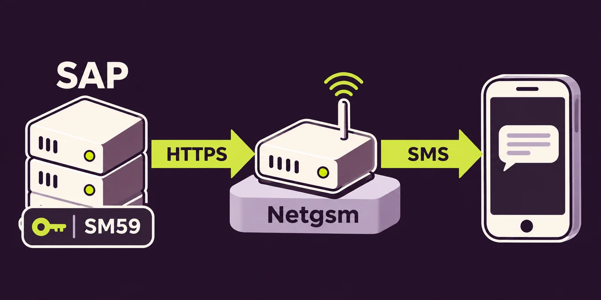
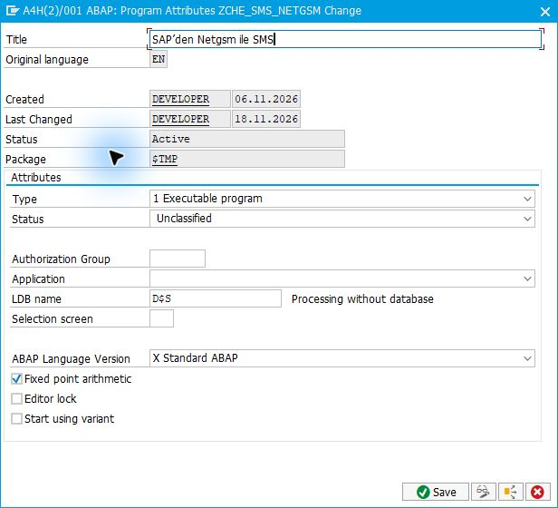
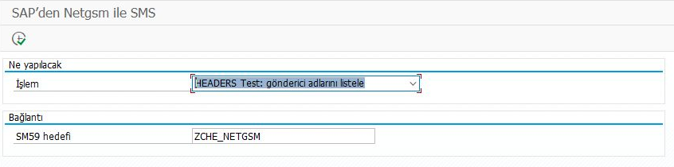
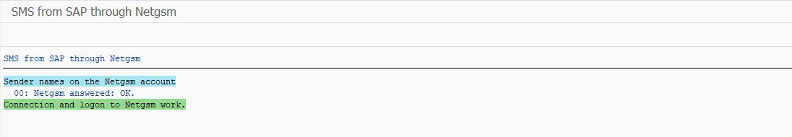
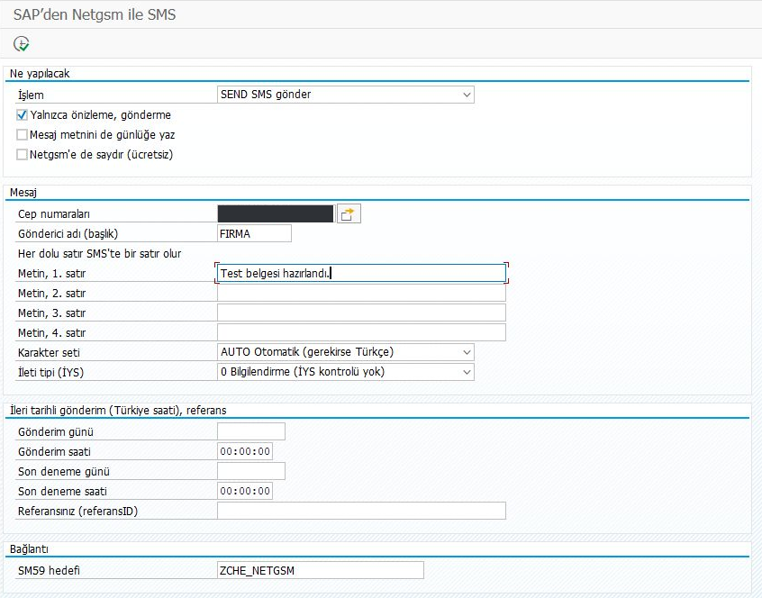
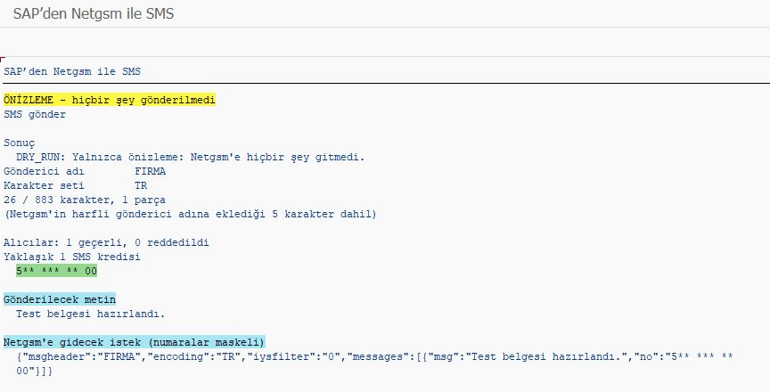
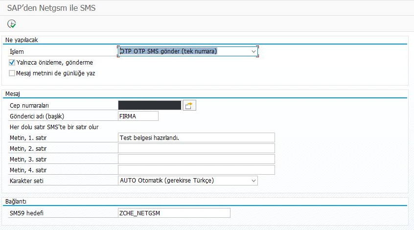
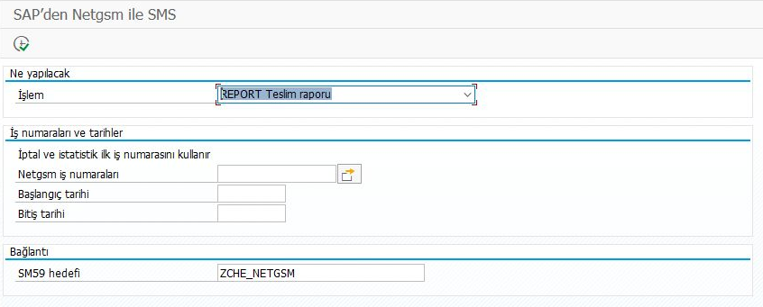
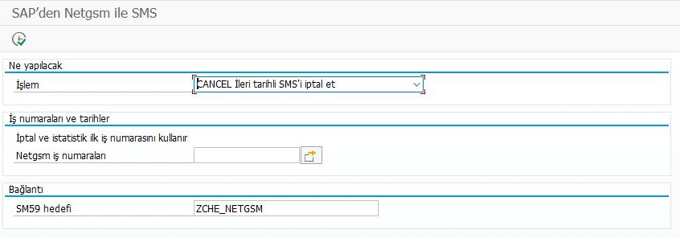
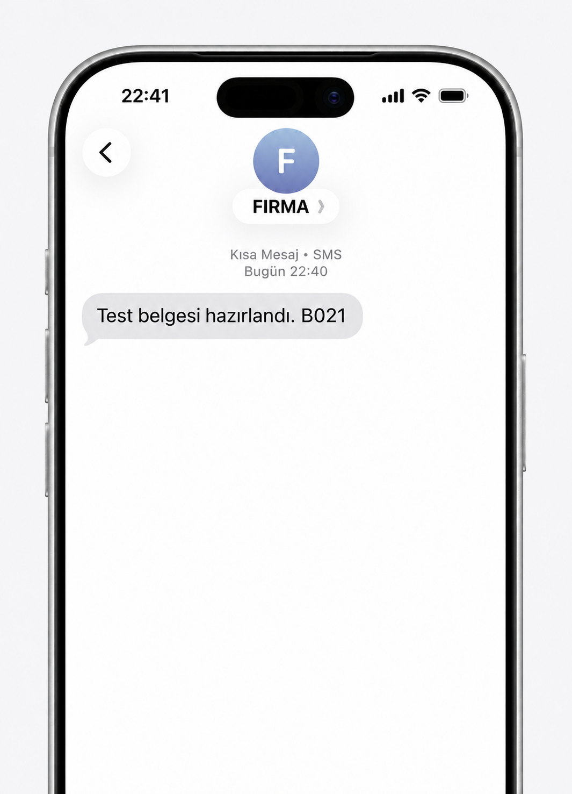

# SAP’den Netgsm ile SMS

[English](WALKTHROUGH.md) · [Ana sayfa](README.tr.md) · [Test sonuçları](VALIDATION.tr.md)

SAP mesajı hazırlar ve SM59’da tanımlı bağlantı üzerinden Netgsm’e iletir. Netgsm de SMS’i alıcıya gönderir. İlk kurulumda gönderici adı başvurusunu erken başlatın. Onayı beklerken bağlantıyı sınayabilir ve SAP’de ücretsiz önizleme yapabilirsiniz.

[İlk kurulum](#kurulum) · [Bağlantıyı sına](#baglanti-testi) · [Örnek SMS hazırla](#onizleme) · [Gönderimi takip et](#takip) · [Gelen SMS](#gelen-sms) · [İş istatistikleri](#is-istatistikleri) · [Arka plan gönderimi](#arka-plan)



<a id="kurulum"></a>

### 1. Netgsm hesabını hazırlayın

1. **Gönderici adı.** Ana hesapta **SMS → SMS Ayarları → Gönderici Adlarım** sayfasını açın. Başvuru belge yükleme ve KEP üzerinden iletim ister. Test hesabında kimlik ve yetki yazısı da istendi. Onay günler sürebilir. Onaylanan adı SAP’ye aynı yazımla girin. Abone numarasını gönderici adı olarak kullanan OTP denemesi `40` döndürdü.
2. **Paket.** Standart ve şablonlu iletiler için Toplu SMS, tek numaraya tek parçalık kod için OTP SMS kullanılır.
3. **API alt kullanıcısı.** **Abonelik İşlemleri → Alt Kullanıcı Hesapları** altında API tipinde onaylı bir alt kullanıcı ve **SMS Hizmeti** yetkisi gerekir. Panel notuna göre bu uygulama 15.02.2024’te başladı. SM59’da kullanıcı adı abone numarası, parola API alt kullanıcısının şifresidir. Paneldeki API anahtarı v3 içindir. Program REST v2 ve HTTP Basic kullanır.
4. **IP izni.** Ağ ekibinizden SAP uygulama sunucusunun internete çıktığı genel IP adresini öğrenin. **API İşlemleri → API IP Erişim Yönetimi** listesini bu adresle karşılaştırın. İzin eksikken testte `30` döndü ve hesap sahibi ücretsiz uyarı SMS’i aldı. **Bildirimler → Mesaj** bölümünden kontrol edebilirsiniz.
5. Test notlarındaki panel duyurusuna göre 01.04.2026’dan itibaren panelden SMS göndermek için e-İmza veya Mobil İmza ile giriş gerekiyor. SAP API üzerinden ayrı kimlik doğrular. Ticari iletiler için hesabınızın İYS ayarlarını kontrol edin.

Menü adları Kasım 2026 test notlarından alınmıştır.

### 2. Programı kurun

1. [`src/zche_sms_netgsm.prog.abap`](src/zche_sms_netgsm.prog.abap) dosyasını açın ve tamamını kopyalayın (**Copy raw file**).
2. **SE38**'de `ZCHE_SMS_NETGSM` programını oluşturun: başlık `SAP’den Netgsm ile SMS`, tip **Yürütülebilir program**, paketiniz (denemek için **Yerel nesne**).
3. SE38'in koyduğu her şeyi silin, yapıştırın ve **aktifleştirin** (Ctrl+F3).
4. Kontrol: **Program → Yürüt → Birim testleri** (ADT'de Ctrl+Shift+F10). Sonuçta **51 testin** geçtiğini ve hata sayısının sıfır olduğunu kontrol edin. Testler sahte bir HTTP katmanı kullanır, Netgsm'i hiç çağırmaz.

Aşağıdaki SE38 görüntüsü A4H/001’deki program özelliklerini gösterir. Gönderim adımlarında Türkçe işlem adlarını kullanıyoruz. Önceki testten kalan bazı sonuç ekranları İngilizcedir.

**Aktifleştirirken "satır çok uzun" hatası alırsanız:** editörünüz eski 72 karakterlik satır ayarında. *Yardımcı programlar → Ayarlar → ABAP Editor → Editör* altında **Downwards-compatible line length (72)** işaretini kaldırıp yeniden yapıştırın. Kaynak 72 sütunu aşmadığı için normalde bu olmaz.

**abapGit (isteğe bağlı):** depo aynı zamanda bir abapGit deposudur; aynı tek programı kurar.



### 3. STRUST: Netgsm sertifikasına güvenmek

Deneme sisteminde ilk çağrı `SSSLERR_PEER_CERT_UNTRUSTED` hatasıyla düştü. Program bunu `NO_TRUST` koduyla gösterir; bu durumda hiçbir şey gitmemiştir. İki adres de aynı sertifikayı kullanıyor (7 Kasım 2026'da bakıldı):

```
*.netgsm.com.tr   (api.netgsm.com.tr ve ext-api.netgsm.com.tr)
 └ Sectigo Public Server Authentication CA DV R36
    └ Sectigo Public Server Authentication Root R46
       └ USERTrust RSA Certification Authority   ← kök, bunu ekleyin
```

1. Kök sertifikayı alın. Ya tarayıcıda `https://api.netgsm.com.tr` adresini açıp sertifikayı gösterin, **USERTrust RSA Certification Authority**'yi seçip Base64 (`.cer`) olarak dışa aktarın, ya da Sectigo'nun sitesinden indirin.
2. **STRUST**'ta **SSL client Anonymous**'u açın. Bu `ANONYM`'dir; hedefinizin kendi PSE'si varsa onu kullanın.
3. **Sertifikayı içe aktar** → dosya → **Sertifika listesine ekle** → **Kaydet**.
4. Bağlantı testi hâlâ düşüyorsa Basis'ten ICM'nin PSE'yi yeniden yüklemesini isteyin.

<a id="sm59"></a>

### 4. SM59: bağlantı ve şifre

İki **dış sunucuya HTTP bağlantısı** (tip **G**) oluşturun. Şablon kullanmayacaksanız ikincisi gerekmez.

| Sekme / alan | `ZCHE_NETGSM` | `ZCHE_NETGSM_EXT` (şablonlar) |
|---|---|---|
| Teknik ayarlar → Host | `api.netgsm.com.tr` | `ext-api.netgsm.com.tr` |
| Port | `443` | `443` |
| Yol öneki (Path prefix) | **boş**; program `/sms/rest/v2/...` yolunu kendisi gönderir | **boş** |
| Oturum açma ve güvenlik → Temel kimlik doğrulama → Kullanıcı | Netgsm **kullanıcı kodu** (1. adım) | aynısı |
| Şifre | **API alt kullanıcısının şifresi** (1. adım) | aynısı |
| Oturum açma ve güvenlik → SSL | **Aktif**, sertifika listesi **ANONYM** (ya da 3. adımdaki PSE) | aynısı |
| Oturum açma ve güvenlik → Hedef için yetki (Authorization for Destination) | `ZCHE_NETGSM` (önerilir, aşağıya bakın) | `ZCHE_NETGSM_EXT` |

Başka adlar da olur; ekrandaki *SM59 hedefi* alanlarına yazarsınız.

SAP şifreyi kendi güvenli deposunda saklar. Program şifreyi hiç okumaz; SM59 onu her isteğe HTTP Basic kimlik doğrulaması olarak ekler.

**Kim gönderebilir?** *Hedef için yetki* alanı doluysa SAP hedefi yalnızca **`S_ICF`** yetki nesnesinde `ICF_FIELD = DEST`, `ICF_VALUE = <hedef>` olan kullanıcılara açar. Program aynı kontrolü önizlemeden ve her çağrıdan önce kendisi de yapar; yetki eksikse açık bir mesaj (`NO_AUTH`) verir. `S_ICF`'i SMS gönderebilecek kişilerin ve batch kullanıcısının rolüne ekleyin. Programı kimin başlatabileceğini sınırlamak için `S_PROGRAM` ya da bir işlem kodu kullanın.

<a id="baglanti-testi"></a>

### 5. İlk çalıştırma: bağlantı testi

SA38’de `ZCHE_SMS_NETGSM` programını açın. **İşlem** alanında **HEADERS – Test: gönderici adlarını listele** seçin. **SM59 hedefi** alanında standart bağlantınızın adını kontrol edip **Çalıştır** (F8) düğmesine basın. Bu sorgu ücretsizdir.



**Sonucu okuyun.** A4H’de Netgsm `00` döndürdü. Bu, SAP’nin bağlanıp giriş yapabildiğini gösterir. Aşağıdaki örnekte ad listesi boş. Gerçek SMS göndermek için listede hesabınıza ait onaylı bir ad görmeniz gerekir.



| Cevap | Anlamı |
|---|---|
| `NO_DEST` | SM59 hedefi yok ya da G tipi değil. |
| `NO_AUTH` | Kullanıcınızda hedef için `S_ICF` yetkisi yok. |
| `NO_TRUST` | STRUST adımı eksik. Hiçbir şey gitmedi. |
| `NO_CONN` | Bağlantı yok: ağ, proxy ya da güvenlik duvarı. |
| `30` | Sırasıyla SAP çıkış IP iznini, API alt kullanıcısının şifresini ve alt kullanıcının onayını/API erişimini kontrol edin. |

<a id="onizleme"></a>

### 6. Önce önizleme, sonra gönderim

**Mesajı hazırlayın.** **İşlem** alanında **SEND – SMS gönder** seçin. Ekrandaki örneği denemek için aşağıdaki değerleri girin. **Yalnızca önizleme, gönderme** işaretli, **Netgsm’e de saydır** boş kalsın.

| SAP alanı | Önizleme için örnek değer |
|---|---|
| Cep numaraları | `05000000000` (örnek numara) |
| Gönderici adı (başlık) | `FIRMA` |
| Metin, 1. satır | Test belgesi hazırlandı. |
| Karakter seti | AUTO |



**F8 ile önizleyin.** A4H’de `DRY_RUN` sonucu bir geçerli alıcı, sıfır reddedilen alıcı ve bir SMS parçası gösterdi. Yaklaşık maliyet bir krediydi. Numara sonuçta maskelendi. **Netgsm’e de saydır** seçeneğini ayrıca işaretlerseniz program uzunluğu karşılaştırmak için Netgsm’e ücretsiz bir sorgu gönderir.



**Gerçek gönderime geçtiğinizde** örnek numarayı kendi alıcınızla, `FIRMA` değerini hesabınızdaki onaylı gönderici adıyla değiştirin. Önizleme işaretini kaldırın ve F8’e basın. Onay penceresinde tahmini krediyi kontrol edin. Gönderimi onaylamak ücretli işlemi başlatır. Netgsm kabul ederse dönen **iş numarasını** teslim raporu için saklayın.

<a id="otp"></a>

#### Tek kullanımlık kod göndermek

**OTP – OTP SMS gönder (tek numara)** işlemini seçin. OTP paketi, bir alıcı ve tek parçaya sığan bir metin gerekir. Aşağıdaki görüntü önceki sürümdendir. Güncel sürüm OTP işleminde metni günlüğe yazma kutusunu gizler. Önizleme alıcıyı maskeler, parça sayısını gösterir ve kodu içeren metni veya istek gövdesini listeye yazmaz. Test hesabında onaylı gönderici adı bulunmadığı için canlı OTP denemesinde `40` alındı.



<a id="sablon"></a>

#### Şablonlu SMS hazırlamak

**Şablonları listele** ile numarayı bulun. **Şablonlu SMS gönder** işleminde bu numarayı ve şablondaki her `${ad}` için bir `ad=değer` satırı girin. Şablonlar ikinci SM59 hedefini kullanır. Program şablon metnini göremediği için *Otomatik* karakter setinde Türkçe seçilir.

<a id="takip"></a>

#### Teslimi takip etmek ve ileri tarihli gönderimi iptal etmek

**Teslim raporu.** **REPORT – Teslim raporu** işleminde gönderimden aldığınız iş numarasını girin. Tarih aralığıyla arıyorsanız başlangıç ve bitiş tarihlerini birlikte doldurun. Sonucun görünmesi birkaç dakika sürebilir.



A4H’de yalnızca bir tarih girildiğinde program `BAD_INPUT` döndürüp iki tarihi de istedi. [A4H’de görülen doğrulama mesajı](docs/img/S25-report-one-date.png)

**İleri tarihli gönderim.** **SMS gönder** ekranında *Gönderim günü* ve *Gönderim saati* alanlarını Türkiye saatiyle doldurun. *Son deneme günü/saati* isteğe bağlıdır. İptal etmek isterseniz **CANCEL – İleri tarihli SMS’i iptal et** işlemini seçip planlanmış gönderimin iş numarasını girin.



Testte örnek `123` iş numarası için Netgsm `60` döndürdü. Bu kod, iptal edilecek işin bulunamadığını bildirir. [A4H’de görülen iptal sonucu](docs/img/S23-cancel-unknown-job.png)

<a id="gelen-sms"></a>

#### Gelen SMS’leri okuma

**INBOX – Gelen SMS** işlemini seçin. İlk denemede hem başlangıç hem bitiş tarihine aynı günü girip **F8**’e basın. Daha geniş bir sorgu için en fazla 30 günlük aralık kullanın. Liste, mesaj metnini, Türkiye saatiyle alınma zamanını, operatörü ve varsayılan olarak maskeli gönderici numarasını gösterir. `40` o sorguda mesaj bulunmadığı anlamına gelir.

İki tarihi de boş bırakırsanız Netgsm yalnızca yeni mesajları döndürür ve döndürdüklerini listelenmiş olarak işaretler. Aynı iletilere tekrar bakmak için tarih aralığı girin.

<a id="is-istatistikleri"></a>

#### Bir gönderimin istatistiklerini görme

**STATS – Bir işin istatistiği** işlemini seçin. Netgsm’in gönderimi kabul ederken verdiği **tek bir iş numarasını** girin ve **F8**’e basın. Gerekirse gönderim tarihini de ekleyin. Sonuç, Netgsm’in döndürdüğü her durum için SMS sayısını, toplam parça sayısını ve ücret bilgisini gösterir. Tek bir alıcının teslim durumunu görmek için [teslim raporunu](#takip) kullanın.

#### Alıcı telefonunda ne görür?

Örnekte alıcı, **FIRMA** başlığı altında “Test belgesi hazırlandı.” mesajını görür. `B021`, Netgsm’in harfli gönderici adıyla yollanan SMS’e eklediği koddur. Aşağıdaki görsel temsili olarak üretildi. Test hesabında onaylı gönderici adı olmadığı için telefona teslim doğrulanamadı.



### 7. Uygulama günlüğü (isteğe bağlı)

SLG1'de kayıt tutmak için **SLG0**'da bir kez **`ZCHE_SMS`** günlük nesnesini oluşturun; alt nesne gerekmez. Nesne olmadan da program çalışır: sonuç yalnızca listede ve job günlüğünde olur, liste de bunu söyler. Günlükte işlem, kod, iş numarası, gönderici adı, karakter seti, parça sayısı ve **maskeli** numaralar bulunur. Standart SMS metnini kaydetmek için **Mesaj metnini de günlüğe yaz** seçeneğini işaretleyebilirsiniz. OTP metni uygulama günlüğüne, sonuç listesine veya bu listenin arka plan makarasına yazılmaz. Önceden kaydedilmiş bir varyantta metin kaydı açık olsa da bu kural geçerlidir.

## Kendi programlarınızdan kullanım

```abap
DATA lt_numbers TYPE string_table.
DATA lv_code    TYPE string.
DATA lv_jobid   TYPE string.
DATA lv_message TYPE string.

APPEND `0500 000 00 00` TO lt_numbers.          " uydurma numara
PERFORM send_sms IN PROGRAM zche_sms_netgsm IF FOUND
  USING    lt_numbers `ZFI_CLOSE hata verdi, SM37'ye bakın` `FIRMA`
           abap_true
  CHANGING lv_code lv_jobid lv_message.

WRITE: / lv_code, lv_message.  " Expected: DRY_RUN
```

| FORM | Ne için |
|---|---|
| `send_sms` | numaralar, metin, gönderici adı, önizleme |
| `send_sms_opt` | ayrıca karakter seti (`AUTO`, `TR`, `UNICODE`, `ASCII`), İYS tipi (`0`, `11`, `12`), metni günlüğe yazma |
| `send_sms_at` | ayrıca ileri tarih (`lif_sms=>ty_schedule`, Türkiye saati) ve referansınız |
| `send_otp` | tek numara, metin, gönderici adı, Türkçe harfleri sadeleştirme, önizleme |
| `send_template` | numaralar, şablon numarası, `ad=değer` satırları, gönderici adı, önizleme |
| `cancel_sms` | ileri tarihli gönderimin iş numarası |

- Gönderimde `00`, `01` veya `02` kabul sonucudur. Dönen iş numarasını saklayın ve teslimi rapordan kontrol edin.
- Önizleme işaretliyse her şey kontrol edilir, hiçbir şey gönderilmez (`DRY_RUN`).
- Onay penceresi ve liste yok. Hedefler `ZCHE_NETGSM` ve `ZCHE_NETGSM_EXT`; çağıran kullanıcının bunlar için `S_ICF` yetkisi olmalı.
- Günlük kaydı çağıranın LUW'unda yazılır. Çağıran ROLLBACK yaparsa kayıt da gider.

<a id="arka-plan"></a>

### Arka plan işinden gönderim

1. Kendi çalıştırılabilir Z programınıza yukarıdaki `PERFORM send_sms` örneğini ekleyin. OTP için `send_otp`, şablon için `send_template` kullanın. Bu çağrılar onay penceresi açmadan sonuç kodunu, iş numarasını ve açıklamayı döndürür.
2. **SM36**’da iş adımı olarak kendi programınızı seçin. İş kullanıcısına gereken SM59 hedefi için `S_ICF` yetkisini verin. İlk çalıştırmada önizleme parametresi `abap_true` kalsın. **SM37**’de işin makara çıktısında örneğin yazdığı `DRY_RUN` sonucunu kontrol edin.
3. Ücretli gönderim için gerçek alıcıyı ve onaylı gönderici adını girip önizleme parametresini `abap_false` yapın. Bağlantı kesilirse yeniden göndermeden önce Netgsm panelini veya teslim raporunu kontrol edin.

A4H denemesinde etkileşimli seçim ekranını ekransız `SUBMIT`/RFC üzerinden çağırmak, onay penceresinde kısa döküm verdi. Arka plan entegrasyonu için yukarıdaki alt yordamı kullanın. Gerçek bir arka plan işinden telefona teslim henüz doğrulanmadı.

## Karakterler, uzunluk ve maliyet

Netgsm dokümanına göre:

| Karakter seti | Tek parça | bölünürse parça başına | 6 parçada en fazla |
|---|---|---|---|
| GSM (Türkçe harf yok) | 160 | 153 | 912 |
| Türkçe (`TR`) | 155 | 148 | 883 |
| Unicode (ör. emoji) | 70 | 66 | 391 |
| OTP SMS | 160, yalnızca tek parça | | |

- `ç ğ ı ş Ğ İ Ş` ve `€ [ ] { } ^ ~ \ |` **iki** karakter sayılır.
- Harf içeren gönderici adında Netgsm metnin sonuna " B021" ekler (2016'dan beri BTK kuralı). Bu 5 karakter tutar ve program bunu hesaba katar; bu yüzden OTP'de 155 karakter kalır.
- **ASCII** seçeneği Türkçe harfleri göndermeden önce Latin harflerine çevirir (ç → c). Daha ucuzdur, ama metin değişir. Metin Türkçe harf içeriyorsa OTP SMS için bu seçenek gerekir.
- Netgsm **alıcı sayısı × parça sayısı** kadar ücret alır. Program bu tahmini gösterir; geçerli olan Netgsm faturasıdır. Şablonlu SMS'te parça sayısı gönderimden önce bilinmez.

## Sonuç kodları

Netgsm aynı kodu farklı servislerde farklı anlamda kullanıyor; program her birini bağlamına göre açıklar.

| Kod | Anlamı |
|---|---|
| `00` | Kabul edildi (gönderim) / tamam (diğerleri). |
| `20` | Metinde sorun var ya da metin çok uzun. |
| `30` | Sırasıyla SAP çıkış IP iznini, API alt kullanıcısının şifresini ve alt kullanıcının onayını/API erişimini kontrol edin. |
| `40` | Gönderici adı tanımlı değil (gönderim, OTP). Gelen SMS'te: yeni mesaj yok. |
| `50`, `51` | Hesap İYS kontrollü gönderim yapamıyor / İYS marka kodu yok. OTP'de: numarayı kontrol edin. |
| `60` | Rapor: kayıt yok. İptal: böyle bir iş yok. OTP: OTP paketi yok. Gelen SMS: aralık 30 günden uzun. |
| `70` | Hatalı ya da eksik parametre. |
| `80` | Sınır aşıldı. |
| `85` | Aynı numaraya bir dakikada 20'den fazla iş. |
| `100`–`110` | Netgsm sistem hatası. |
| `NOT_FOUND`, `UNAUTHORIZED`, `BAD_REQUEST` | Şablon: böyle bir numara yok / izin yok / eksik değer. |
| `DRY_RUN` | Önizleme: her şey kontrol edildi, hiçbir şey gönderilmedi. |
| `BAD_NUMBER`, `BAD_TEXT`, `BAD_INPUT` | Program Netgsm'i çağırmadan reddetti. |
| `NO_DEST`, `NO_AUTH` | SM59 hedefi yok ya da tipi yanlış / `S_ICF` yetkisi yok. |
| `NO_TRUST` | Sertifikaya güvenilmiyor (STRUST). Hiçbir şey gitmedi. |
| `NO_CONN` | Cevap gelmedi. **SMS gitmiş de olabilir, gitmemiş de**: tekrar göndermeden önce teslim raporuna ya da Netgsm paneline bakın. |
| `HTTP_ERROR`, `BAD_REPLY` | HTTP hatasında okunabilir servis kodu yoksa `HTTP_ERROR`. HTTP 406 içindeki okunabilir JSON kodu sonuçta gösterilir. `BAD_REPLY` okunamayan servis yanıtıdır. |

## Neden Netgsm REST v2, neden v3 değil

Netgsm'in iki SMS API'si var. Yeni olan v3, token almak için şifrenin bir JSON gövdesine yazılmasını istiyor. Bunu SM59 yapamaz, yani kodun şifreyi okuması gerekirdi. v2 ise HTTP Basic kimlik doğrulamasını kabul ediyor ve bunu SM59 kendisi gönderiyor. Böylece şifre koddan uzak kalıyor. Netgsm'in JavaScript SDK'sı v2 için "legacy" diyor, ama dokümanda bir bitiş tarihi yok.

## Kaynaklar

- Netgsm dokümanı (REST v2): <https://www.netgsm.com.tr/dokuman/>
- Netgsm SMS API v3 dokümanı: <https://api-docs.netgsm.com.tr/>
- [Tasarım kararları](DESIGN.md)
